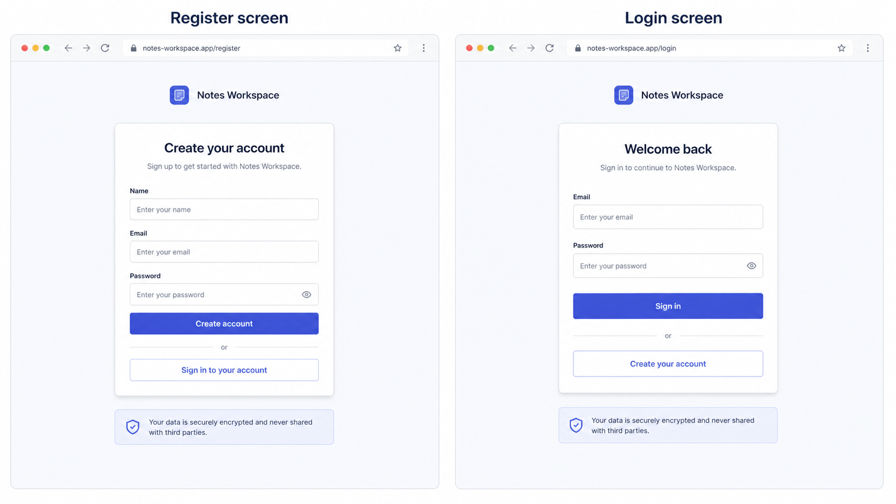
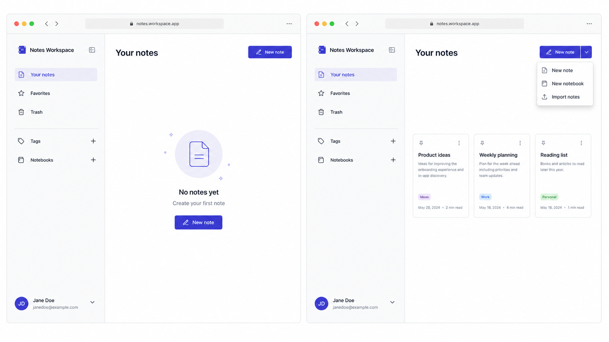
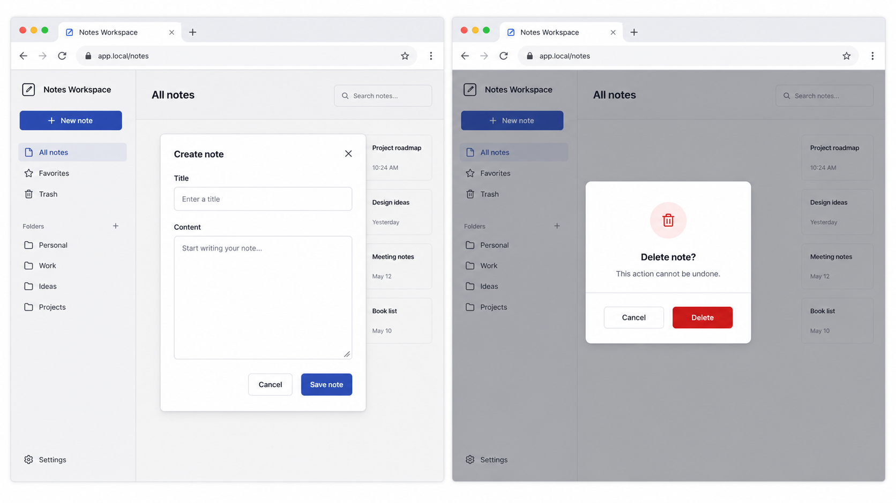
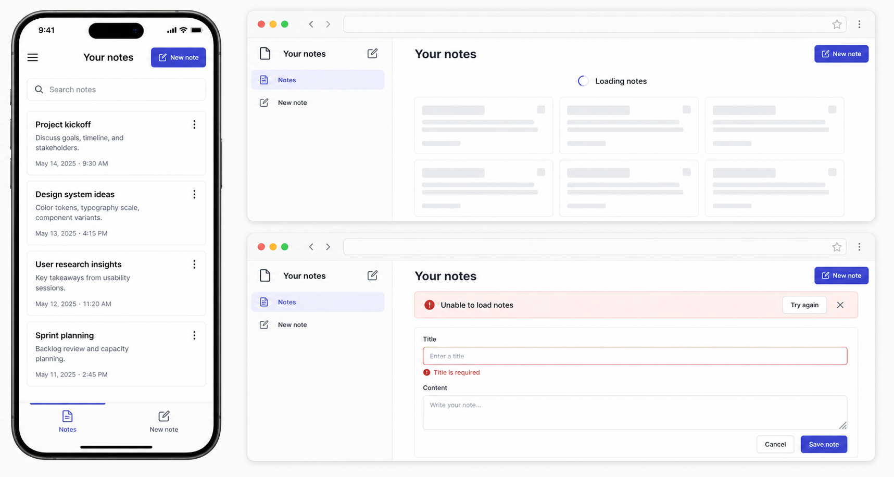

# Notes Workspace frontend exercise

Build the frontend for a small authenticated notes product. The PostgreSQL database, Prisma models, cookie-based authentication, REST API, API client helper, types, and shadCN/ui component set are already supplied. Your work is the responsive frontend: layouts, reusable components, states, and API integration.

The page currently shown at `/` is only a starting screen. Replace it with the assigned application.

This is a one-week individual exercise due **Tuesday, September 1, 2026**. Read [EXPECTED-RESULT.md](EXPECTED-RESULT.md) for the ordered build checklist and [TRAINING-GUIDE.md](TRAINING-GUIDE.md) for the branch, review, communication, and submission process.

## What you must deliver

- Registration, login, and logout flows.
- An authenticated notes workspace where each user can create, read, update, and delete only their own notes.
- Reusable auth, layout, shared, and notes components.
- Complete desktop, tablet, and mobile behavior.
- Loading, empty, error, validation, success, and destructive-confirmation states.
- A clean TypeScript implementation that passes `npm run lint` and `npm run build`.

## Project structure

The backend and component kit are already placed. Add your frontend files only in the indicated areas.

```text
notes-workspace-training/
├── prisma/
│   ├── migrations/                 # generated database migrations
│   ├── schema.prisma               # supplied User and Note models
│   └── seed.ts                     # supplied demo account and notes
├── public/docs/                    # supplied visual references
├── scripts/test-api.ts             # supplied end-to-end API smoke test
├── src/
│   ├── app/
│   │   ├── (auth)/
│   │   │   ├── layout.tsx          # you build: centered auth layout
│   │   │   ├── login/page.tsx      # you build
│   │   │   └── register/page.tsx   # you build
│   │   ├── notes/
│   │   │   ├── loading.tsx         # you build
│   │   │   ├── error.tsx           # you build
│   │   │   └── page.tsx            # you build
│   │   ├── api/                    # supplied; do not redesign
│   │   │   ├── auth/
│   │   │   └── notes/
│   │   ├── globals.css             # supplied theme; extend sparingly
│   │   ├── layout.tsx
│   │   └── page.tsx                # replace supplied start screen
│   ├── components/
│   │   ├── ui/                     # supplied shadCN components; use these
│   │   ├── auth/                   # you build auth forms/cards
│   │   ├── layout/                 # you build app shell/sidebar/header
│   │   ├── notes/                  # you build note list/cards/editor
│   │   └── shared/                 # you build reusable state components
│   ├── lib/
│   │   ├── api/client.ts           # supplied fetch helper
│   │   ├── api-response.ts
│   │   ├── auth.ts
│   │   ├── db.ts
│   │   ├── utils.ts
│   │   └── validations.ts
│   └── types/api.ts                # supplied response types
├── .env.example
├── components.json
├── docker-compose.yml
├── EXPECTED-RESULT.md             # ordered one-week implementation checklist
├── TRAINING-GUIDE.md              # Git, review, communication, and submission
└── package.json
```

## UI rules

All visible controls and product surfaces must be composed from the supplied components in `src/components/ui`. Do not install another component library.

Do not write raw equivalents such as:

```tsx
<button />
<input />
<textarea />
<select />
<dialog />
<div className="rounded-xl border p-6" />
```

Use `Button`, `Input`, `Textarea`, `AlertDialog`, `Card`, `Sheet`, and the other supplied components instead. Semantic layout elements such as `main`, `section`, `header`, `nav`, and `aside` are allowed for document structure. The required `html` and `body` elements in the root Next.js layout are also allowed. Do not edit shadCN source merely to bypass this rule.

The supplied set is:

`Alert`, `AlertDialog`, `Avatar`, `Badge`, `Button`, `Card`, `DropdownMenu`, `Empty`, `Input`, `Label`, `Separator`, `Sheet`, `Skeleton`, `Sonner`, and `Textarea`.

Lucide icons are installed. Icons must have an accessible label or be hidden from assistive technology when decorative.

## Reuse and layout expectations

- Pages compose features; they must not contain an entire screen implementation in one file.
- Build one `AuthLayout` and one configurable `AuthForm` or shared field group for both auth screens.
- Build one `AppShell` that owns desktop navigation, mobile navigation, page width, and the account/logout area.
- Build one `NoteForm` used for both create and edit modes.
- Build one `NoteCard` rendered from data; do not duplicate card markup.
- Build shared `EmptyState`, `ErrorState`, and loading skeleton components.
- Keep API requests in a small feature-level client or hooks layer, not scattered through presentation components.
- Display server errors and field validation errors. Never rely on `console.log` as user feedback.
- Disable submitting controls while a mutation is pending and prevent duplicate submissions.
- After create, edit, or delete, the visible list must update without a full browser refresh.

## Recommended frontend architecture

Use this arrangement to keep routing, data work, and presentation separate:

```text
App Router pages and layouts
│
├── (auth)/layout.tsx
│   └── AuthLayout
│       └── login/page.tsx or register/page.tsx
│           └── AuthForm
│               └── shared fields + api() calls
│
└── notes/page.tsx
    └── AppShell
        ├── DesktopSidebar
        ├── MobileNavigation (Sheet)
        ├── AccountMenu
        └── NotesWorkspace
            ├── NotesHeader
            ├── NotesGrid
            │   └── NoteCard[]
            ├── EmptyState
            ├── NotesSkeleton
            ├── ErrorState
            ├── NoteEditor (Sheet)
            │   └── NoteForm
            └── DeleteNoteDialog (AlertDialog)
```

Suggested file arrangement:

```text
src/components/
├── auth/
│   ├── auth-layout.tsx
│   ├── auth-form.tsx
│   └── password-input.tsx
├── layout/
│   ├── app-shell.tsx
│   ├── desktop-sidebar.tsx
│   ├── mobile-navigation.tsx
│   └── account-menu.tsx
├── notes/
│   ├── notes-workspace.tsx
│   ├── notes-header.tsx
│   ├── notes-grid.tsx
│   ├── note-card.tsx
│   ├── note-editor.tsx
│   ├── note-form.tsx
│   └── delete-note-dialog.tsx
└── shared/
    ├── empty-state.tsx
    ├── error-state.tsx
    └── loading-state.tsx
```

Component ownership rules:

| Layer                    | Responsible for                                          | Must not contain                     |
| ------------------------ | -------------------------------------------------------- | ------------------------------------ |
| Page/layout              | Route composition, redirects, shell selection            | Repeated field or card markup        |
| Workspace/feature        | Notes state, request coordination, opening editor/dialog | Raw replacements for shadCN controls |
| Form                     | Field state, client validation, submit/pending errors    | Routing shell or note-list rendering |
| Presentational component | Rendering typed props and emitting user actions          | Direct database access               |
| `api()`/feature client   | HTTP method, payload, response type                      | Toasts, dialogs, or visual state     |

## Connecting the frontend to the API

Use one predictable flow for every screen:

```text
User action
   ↓
Reusable component validates local input
   ↓
Feature/workspace sets pending state
   ↓
api<T>(path, request options)
   ↓
Next.js route handler validates session + payload
   ↓
Prisma reads or writes PostgreSQL
   ↓
Typed { data: ... } response or { error: ... }
   ↓
Feature updates visible state
   ↓
Close editor/dialog only on success and show Sonner feedback
```

The page should visually follow this state order:

```text
request begins → matching Skeleton or disabled control
request succeeds with items → NotesGrid
request succeeds with no items → EmptyState
request fails → Alert/ErrorState + working Retry action
mutation succeeds → update list + close overlay + toast
mutation fails → keep user input/overlay open + show error
```

### API-to-screen connection map

| Screen or action                        | Endpoint                  | Frontend responsibility after response                 |
| --------------------------------------- | ------------------------- | ------------------------------------------------------ |
| App/session startup                     | `GET /api/auth/me`        | Store the user or redirect a `401` to Login            |
| Register submit                         | `POST /api/auth/register` | Show field/server errors or navigate to Notes          |
| Login submit                            | `POST /api/auth/login`    | Show invalid credentials or navigate to Notes          |
| Account-menu logout                     | `POST /api/auth/logout`   | Clear user/note state and navigate to Login            |
| Notes page load/retry                   | `GET /api/notes`          | Render skeleton, empty state, grid, or retryable error |
| Create-note save                        | `POST /api/notes`         | Add returned note at the top and close editor          |
| Open a direct note view, if implemented | `GET /api/notes/:id`      | Render the owned note or a not-found state             |
| Edit-note save                          | `PATCH /api/notes/:id`    | Replace the matching card with returned note           |
| Confirm deletion                        | `DELETE /api/notes/:id`   | Remove the note; show empty state if none remain       |

Keep one source of truth for the notes currently on screen. Do not separately update several copies of the same list. A lightweight React state/hook implementation is sufficient; an additional state-management package is not required.

### Recommended authenticated loading sequence

```tsx
const [userResult, notesResult] = await Promise.all([
  api<UserResponse>("/api/auth/me"),
  api<NotesResponse>("/api/notes"),
]);
```

If your routing approach must resolve the user first, load `/api/auth/me`, handle `401`, and then load notes. In either approach, the screen must not briefly show protected notes UI to a signed-out visitor.

### Recommended mutation pattern

```tsx
setIsSaving(true);

try {
  const result = await api<NoteResponse>("/api/notes", {
    method: "POST",
    body: JSON.stringify(values),
  });

  setNotes((current) => [result.data.note, ...current]);
  setEditorOpen(false);
  toast.success("Note created");
} catch (error) {
  setSubmitError(
    error instanceof Error ? error.message : "Unable to save note",
  );
} finally {
  setIsSaving(false);
}
```

For edit, replace the matching item by ID. For delete, remove the matching item by ID. Keep the form or confirmation open on failure so the user can retry.

## Screen chassis

The chassis below is the implementation specification. The images are supporting references; component choice and behavior here take precedence.

### 1. Register

Component composition:

```text
AuthLayout
└── Card
    ├── CardHeader → product mark, CardTitle, CardDescription
    ├── CardContent
    │   └── RegisterForm
    │       ├── Label + Input (name)
    │       ├── Label + Input (email)
    │       ├── Label + PasswordInput built from Input + Button
    │       ├── Alert (server error, conditional)
    │       └── Button (submit/loading)
    └── CardFooter → link to Login
```

Validate name, email, and password before submission. On success, the API creates a session; navigate to `/notes`.



### 2. Login

Use the same `AuthLayout`, card spacing, password component, error presentation, and pending behavior as Register. Use `Label + Input` for email, `Label + PasswordInput` for password, `Alert` for invalid credentials, and `Button` for submit. Navigate authenticated users to `/notes`.

### 3. Notes — empty state

Component composition:

```text
AppShell
├── Sidebar (desktop) / Sheet (mobile)
│   ├── product identity
│   ├── active Notes navigation item built with Button
│   └── Avatar + DropdownMenu → Logout
└── NotesPage
    ├── page header → title + Button “New note”
    └── Empty
        ├── EmptyHeader → EmptyMedia + EmptyTitle + EmptyDescription
        └── EmptyContent → Button “Create your first note”
```

Both empty-state actions open the same create-note experience.

### 4. Notes — populated state

Use the same shell and header. Render a responsive list/grid of reusable `NoteCard` components. Each card uses `Card`, title, truncated content, updated date, and `DropdownMenu` actions for Edit and Delete. The latest updated note appears first.



### 5. Create/Edit note

Use one `NoteForm` with `Label + Input` for title and `Label + Textarea` for content. Present it in a responsive `Sheet` or a deliberately sized `Card`/dialog composition. The mode controls heading and submit label. Show field errors beside their fields, show server errors in `Alert`, and keep Cancel available. Save with `POST /api/notes` or `PATCH /api/notes/:id`.

### 6. Delete confirmation

Use `AlertDialog`, never `window.confirm` or a generic `Dialog`. Include the note title when practical, explain that deletion cannot be undone, provide Cancel, and use the destructive action style. Keep the dialog open if the request fails and present the error.



### 7. Responsive mobile layout

- Below `768px`, replace the persistent sidebar with a menu `Button` that opens a `Sheet`.
- Keep the page title and primary create action visible without horizontal scrolling.
- Render note cards in one column with touch targets of at least 44px.
- The editor fills the available mobile width and remains usable with the on-screen keyboard.
- At tablet width, use available space without simply scaling the desktop canvas down.

### 8. Loading, error, and validation states

- Initial notes loading: `Skeleton` components that match the note-card geometry.
- Page/API failure: `Alert` or reusable error card with a working Retry `Button`.
- Empty success: the specified empty state, not a loading skeleton.
- Form validation: accessible inline errors and invalid field styling.
- Mutation pending: disabled action and clear progress label.
- Mutation success: update the interface and use `Sonner` for concise confirmation.



## Responsive targets

Test at minimum:

- Mobile: 375 × 812
- Tablet: 768 × 1024
- Desktop: 1440 × 900

No screen may introduce horizontal overflow. Keyboard focus must remain visible. The layout must remain understandable with long note titles and content.

## Local setup

Requirements: Node.js 20.9 or newer, npm, and either Docker Desktop or a local PostgreSQL server.

```bash
npm install
copy .env.example .env
docker compose up -d
npm run db:generate
npm run db:migrate -- --name init
npm run db:seed
npm run dev
```

On macOS/Linux, use `cp .env.example .env` instead of `copy`. Open `http://localhost:3000`.

The seed account is:

```text
Email: demo@notes.local
Password: DemoPassword123!
```

If you use an existing PostgreSQL server, create a database and replace `DATABASE_URL` in `.env`. Replace `AUTH_SECRET` with a private random value of at least 32 characters before deployment.

Useful commands:

| Command                               | Purpose                                                 |
| ------------------------------------- | ------------------------------------------------------- |
| `npm run dev`                         | Start the local development server                      |
| `npm run build`                       | Create a production build                               |
| `npm start`                           | Run the production build                                |
| `npm run lint`                        | Check the codebase                                      |
| `npm run db:generate`                 | Generate Prisma Client                                  |
| `npm run db:migrate -- --name <name>` | Create and apply a development migration                |
| `npm run db:seed`                     | Load the demo account and notes                         |
| `npm run db:studio`                   | Open Prisma Studio                                      |
| `npm run test:api`                    | Test auth and complete notes CRUD against a running app |

## Authentication flow

1. Register or login with JSON credentials.
2. The API validates credentials and sets an HTTP-only, same-site `notes_session` cookie.
3. Browser requests must use `credentials: "include"`; the supplied `api()` helper already does this.
4. Call `GET /api/auth/me` when the app loads to resolve the current user.
5. A `401` means the session is missing or invalid. Clear client auth state and navigate to `/login`.
6. Logout calls `POST /api/auth/logout`, clears the cookie, clears client state, and navigates to `/login`.

Do not store passwords or the session token in `localStorage` or expose them in frontend state.

## API conventions

- Base URL in development: `http://localhost:3000`.
- Requests and non-empty responses use JSON.
- Authentication uses the HTTP-only cookie set by the API.
- Successful payloads use `{ "data": ... }`.
- Errors use `{ "error": { "message": "...", "details": { ... } } }`.
- Validation failures return `422`; unauthenticated requests return `401`; missing owned notes return `404`.
- Dates are ISO 8601 strings.

Example frontend call using the supplied helper:

```tsx
import { api } from "@/lib/api/client";
import type { NotesResponse } from "@/types/api";

const result = await api<NotesResponse>("/api/notes");
const notes = result.data.notes;
```

For a mutation:

```tsx
const result = await api<NoteResponse>("/api/notes", {
  method: "POST",
  body: JSON.stringify({ title, content }),
});
```

### Register

`POST /api/auth/register`

```json
{
  "name": "Ada Lovelace",
  "email": "ada@example.com",
  "password": "strong-password"
}
```

`201 Created`

```json
{
  "data": {
    "user": {
      "id": "user-id",
      "name": "Ada Lovelace",
      "email": "ada@example.com",
      "createdAt": "2026-08-25T10:00:00.000Z"
    }
  }
}
```

Returns `409` when the email already exists and `422` for invalid fields. A successful response also starts the session.

### Login

`POST /api/auth/login`

```json
{ "email": "ada@example.com", "password": "strong-password" }
```

`200 OK` returns the same `{ data: { user } }` shape as registration. Invalid credentials return `401` with `Invalid email or password`.

### Current user

`GET /api/auth/me`

`200 OK` returns `{ data: { user } }`. No valid session returns `401`.

### Logout

`POST /api/auth/logout`

Returns `204 No Content` and expires the session cookie.

### List notes

`GET /api/notes`

```json
{
  "data": {
    "notes": [
      {
        "id": "note-id",
        "title": "Weekly planning",
        "content": "Prepare sprint priorities.",
        "userId": "user-id",
        "createdAt": "2026-08-25T10:00:00.000Z",
        "updatedAt": "2026-08-25T10:00:00.000Z"
      }
    ]
  }
}
```

Returns an empty array when the user has no notes.

### Create note

`POST /api/notes`

```json
{ "title": "Weekly planning", "content": "Prepare sprint priorities." }
```

Returns `201 Created` with `{ data: { note } }`. Title is required and limited to 120 characters; content is limited to 10,000 characters.

### Read note

`GET /api/notes/:id`

Returns `200` with `{ data: { note } }`, or `404` if the note does not exist or belongs to another user.

### Update note

`PATCH /api/notes/:id`

```json
{ "title": "Updated title", "content": "Updated content." }
```

Returns `200` with `{ data: { note } }`. Send both fields. The same validation rules as create apply.

### Delete note

`DELETE /api/notes/:id`

Returns `204 No Content`, or `404` if the note does not exist or belongs to another user.

## Full product flow

1. A signed-out visitor is sent to Login and can move to Register.
2. Registration creates the user, starts a session, and opens Notes.
3. Login starts a session and opens Notes.
4. Notes loads the current user and their notes in parallel where practical.
5. No notes shows the empty state; existing notes show the responsive list/grid.
6. Create and Edit validate, save through the API, close on success, and update the list.
7. Delete requires confirmation, removes the note on success, and returns to empty state when the last note is removed.
8. Logout ends the server session and returns to Login.
9. Refreshing an authenticated page preserves the session; refreshing a signed-out protected page returns to Login.

## Acceptance criteria

- Every required screen and state is implemented and matches the chassis.
- The frontend uses only the supplied shadCN components for visible controls and surfaces.
- Auth and notes UI are split into reusable components in the provided folders.
- Register, login, session restoration, logout, and protected-route behavior work.
- Notes create, list, read, edit, and delete work against the supplied API.
- One user cannot access another user's note, including by changing an ID in a request.
- Empty, loading, server error, validation error, pending, success, and confirmation states are present.
- The app works at the three required viewport sizes with no horizontal overflow.
- Forms are keyboard-usable, inputs have labels, focus is visible, and dialogs manage focus correctly.
- No password or auth token is placed in browser storage.
- No large duplicated page markup, alternative UI library, or raw replacement for a supplied component is introduced.
- `npm run lint`, `npm run build`, and `npm run test:api` pass.

## Final checklist

- [ ] Register screen and validation
- [ ] Login screen and invalid-credential state
- [ ] Session restoration and protected routing
- [ ] Shared desktop/tablet/mobile application shell
- [ ] Mobile `Sheet` navigation
- [ ] Notes empty state
- [ ] Notes populated state with reusable cards
- [ ] Shared create/edit note form
- [ ] Delete `AlertDialog`
- [ ] Loading skeletons
- [ ] Retryable API error state
- [ ] Inline validation and pending states
- [ ] Success feedback and immediate list updates
- [ ] Logout flow
- [ ] 375px, 768px, and 1440px viewport checks
- [ ] Keyboard and focus check
- [ ] `npm run lint`
- [ ] `npm run build`
- [ ] `npm run test:api` while the app is running
- [ ] Required `TEST_IDS` attributes are mapped to their visible targets
- [ ] Individual `submission/firstname-lastname` branch is pushed
- [ ] Draft pull request is updated and marked ready for final review
- [ ] Pull request remains unmerged
